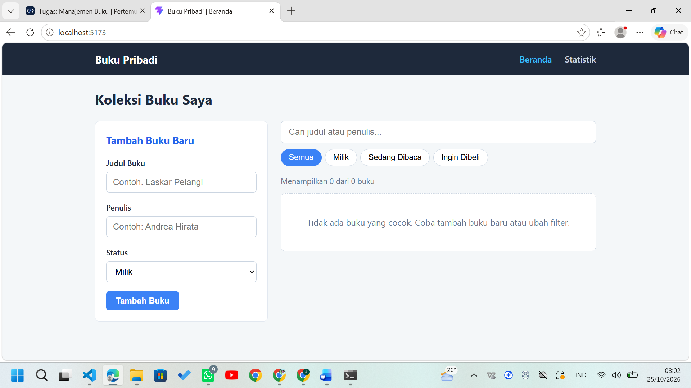
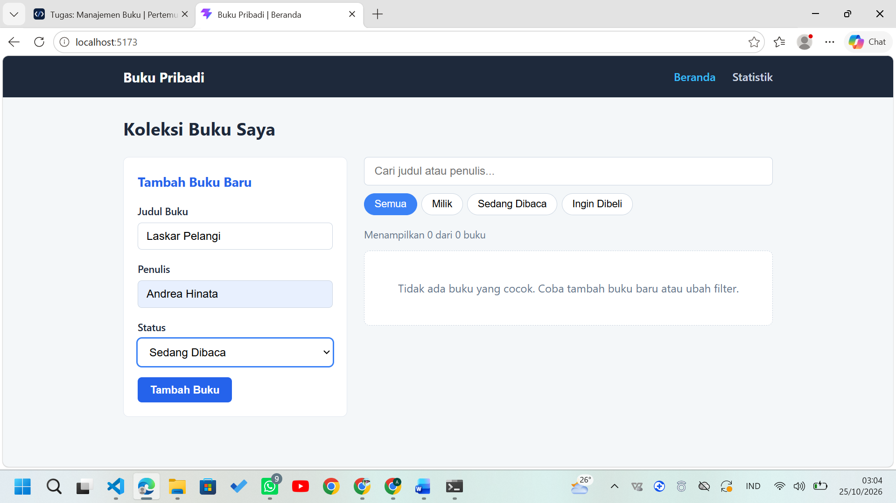
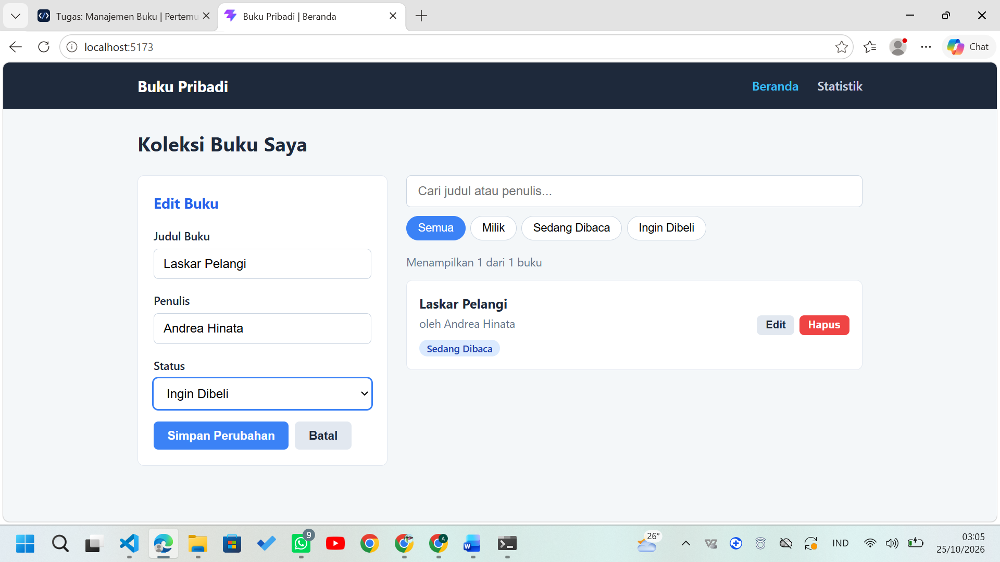
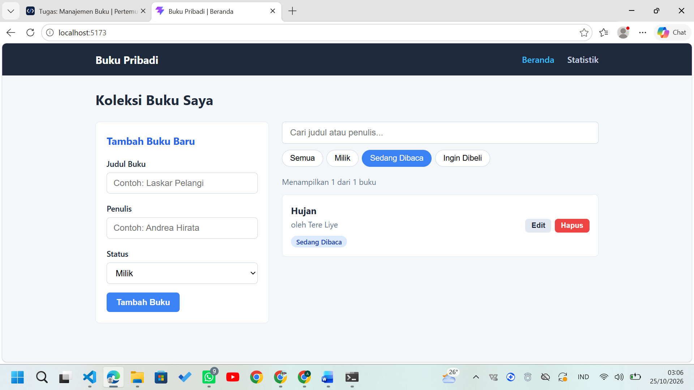
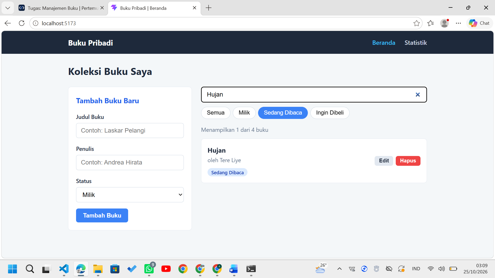
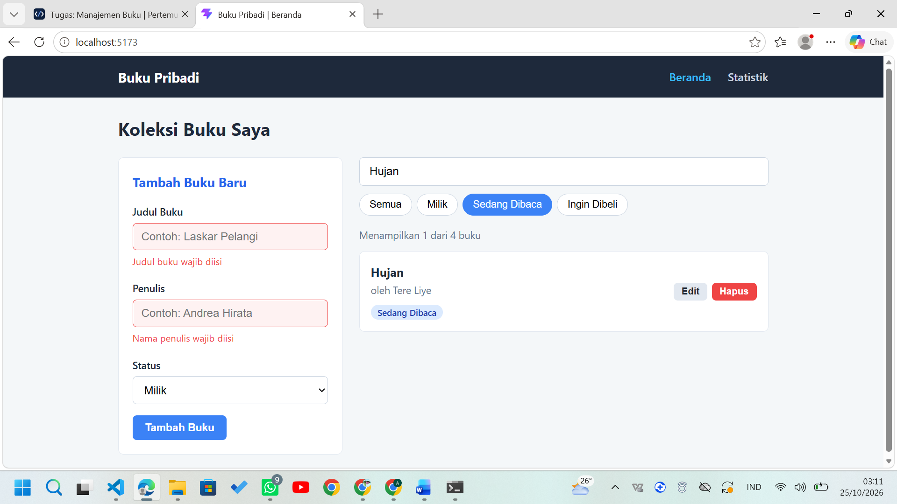
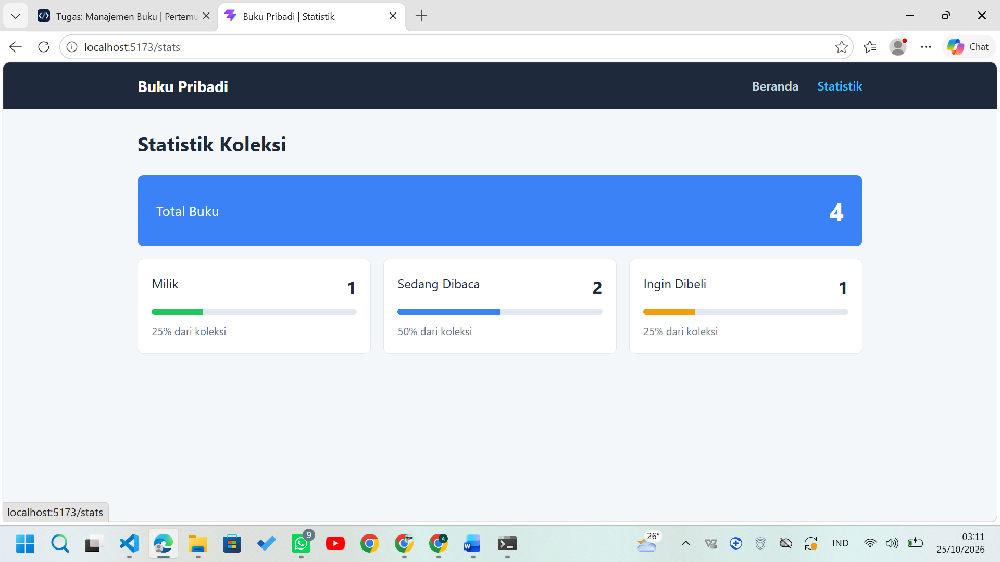
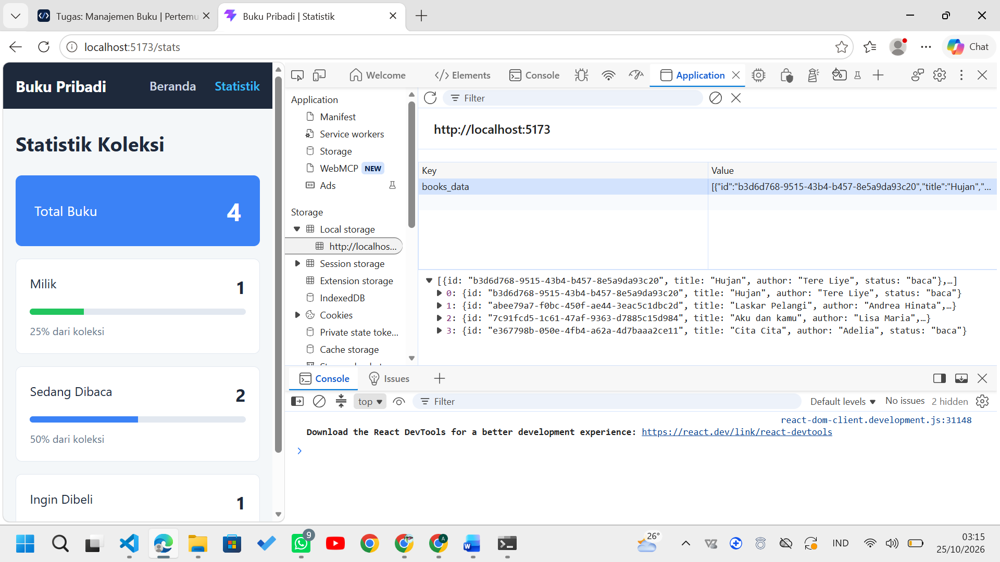
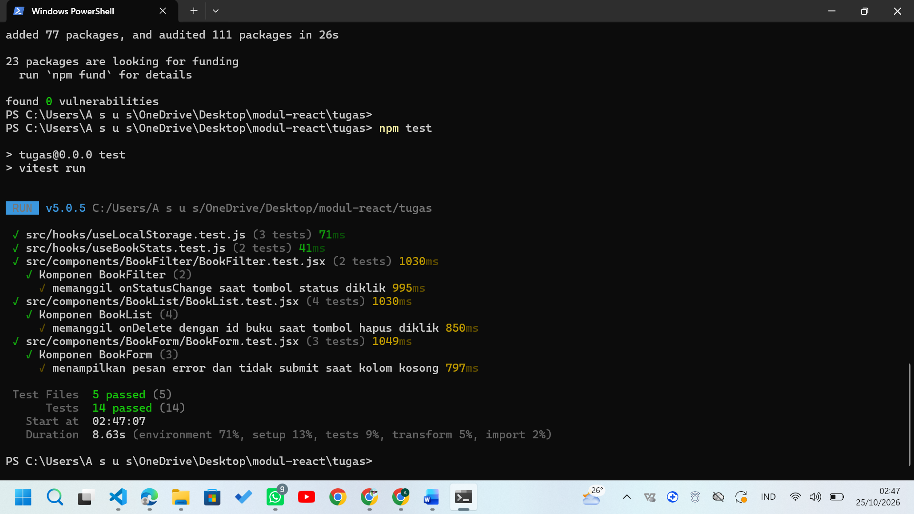

# Aplikasi Manajemen Buku Pribadi

Tugas Pertemuan 3 — Pemrograman Web, Institut Teknologi Sumatera

 --- 
Identitas

| Keterangan | Isi |
|---|---|
| Nama Lengkap | Adelia Eva Ananta |
| NIM | 124140123 |
| Kelas Praktikum | RC |

---

## 1. Deskripsi Aplikasi

Aplikasi web untuk mencatat koleksi buku pribadi. Setiap buku memiliki judul,
penulis, dan status: **Milik**, **Sedang Dibaca**, atau **Ingin Dibeli**.
Data tersimpan di `localStorage` sehingga tidak hilang saat halaman dimuat ulang.

Fitur utama:
- Menambah, mengedit, dan menghapus buku
- Filter berdasarkan status
- Pencarian berdasarkan judul atau nama penulis
- Validasi form dengan umpan balik visual
- Halaman statistik koleksi

## 2. Instalasi dan Cara Menjalankan

Prasyarat: Node.js LTS (v18 atau v20 ke atas).

```bash
cd tugas
npm install
npm install react-router-dom prop-types
npm install -D vitest @testing-library/react @testing-library/dom @testing-library/jest-dom jsdom
npm run dev      # menjalankan aplikasi (http://localhost:5173)
npm test         # menjalankan unit test
```

## 3. Struktur Folder

```
tugas/
├── README.md
├── screenshot/
├── index.html
├── package.json
├── vite.config.js
├── .gitignore
├── .oxlintrc
└── src/
    ├── main.jsx
    ├── App.jsx
    ├── App.css
    ├── constants.js
    ├── setupTests.js
    ├── components/   (Navbar, BookForm, BookList, BookFilter)
    ├── pages/        (Home, Stats)
    ├── hooks/        (useLocalStorage, useBookStats)
    └── context/      (BookContext)
```

## 4. Screenshot Antarmuka

| Halaman | Gambar |
|---|---|
| Beranda |  |
| Tambah buku |  |
| Edit buku |  |
| Filter status |  |
| Pencarian |  |
| Validasi form |  |
| Statistik |  |
| localStorage |  |

## 5. Penjelasan Fitur React yang Digunakan

- **Functional components dan props**: seluruh UI dipecah menjadi komponen
  reusable (`BookForm`, `BookList`, `BookFilter`, `Navbar`).
- **useState**: menyimpan isi form, pesan error, filter status, kata pencarian,
  dan buku yang sedang diedit.
- **useEffect**: menyimpan data ke localStorage (di dalam `useLocalStorage`) dan
  mengatur judul halaman.
- **useMemo**: menghitung `filteredBooks` dan statistik hanya saat data berubah.
- **Context API** (`BookContext`): menyediakan data buku dan fungsi CRUD ke semua
  halaman tanpa prop drilling.
- **React Router**: navigasi `/` (Home) dan `/stats` (Statistik) tanpa reload.
- **Custom hooks**: `useLocalStorage` (persistensi data) dan `useBookStats`
  (perhitungan statistik).
- **PropTypes**: validasi tipe props pada seluruh komponen yang menerima props
  (`BookForm`, `BookList`, `BookFilter`, `BookProvider`). Komponen `Navbar`, `Home`,
  `Stats`, dan `App` tidak menerima props sehingga tidak memerlukan PropTypes.
- **Controlled components**: seluruh input form dikendalikan oleh state.
- **Error handling form**: kolom wajib divalidasi, input kosong diberi border
  merah dan pesan error.
- **Rendering list dengan key**: setiap buku memakai `id` unik (`crypto.randomUUID()`).
- **Komentar kode**: bagian penting (hook, context, validasi form, filter dan
  pencarian, mode edit) diberi komentar penjelas langsung di dalam kode.

## 6. Laporan Testing

Total 14 unit test (Vitest dan React Testing Library):

| File | Jumlah | Yang diuji |
|---|---|---|
| BookForm.test.jsx | 3 | render field, validasi kosong, submit valid |
| BookList.test.jsx | 4 | render data, pesan kosong, hapus, edit |
| BookFilter.test.jsx | 2 | klik status, ketik pencarian |
| useBookStats.test.js | 2 | hitung statistik, daftar kosong |
| useLocalStorage.test.js | 3 | nilai awal, baca data, simpan data |


