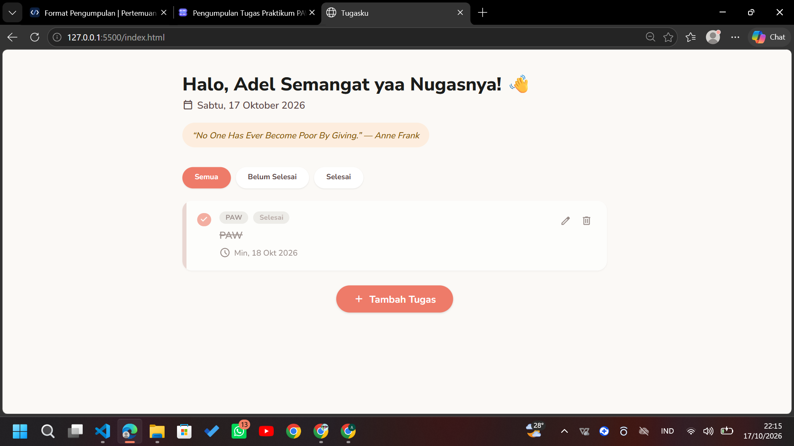
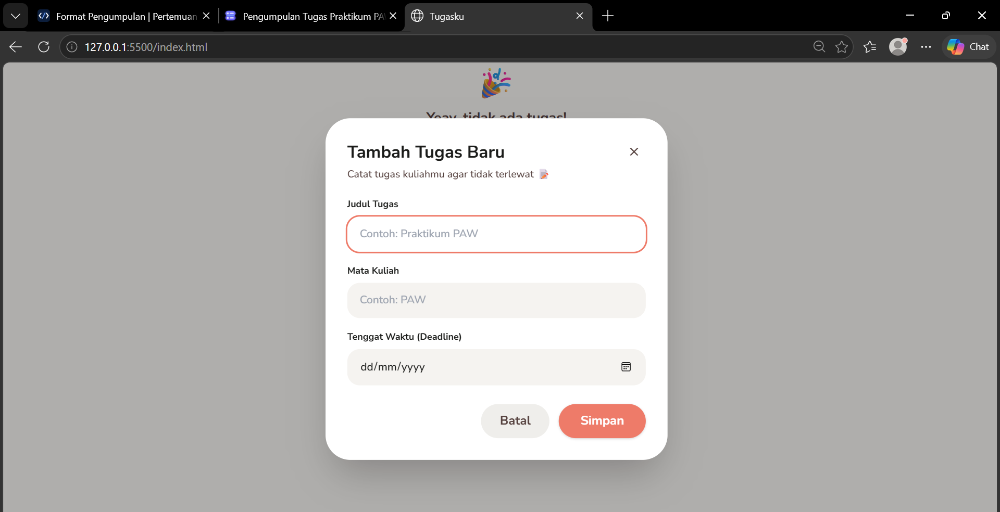
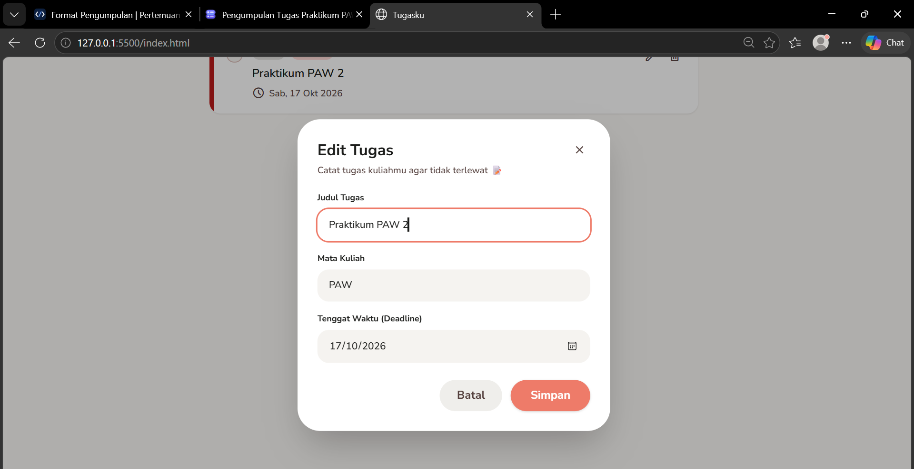
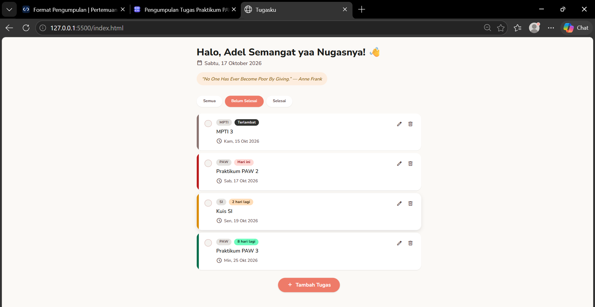
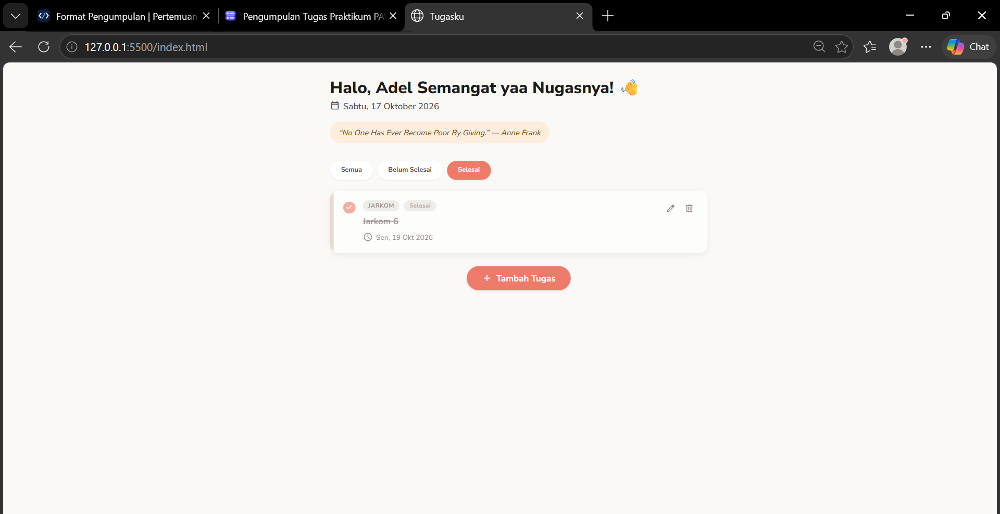

# Tugasku - Personal Dashboard Daftar Tugas Kuliah

Aplikasi web daftar tugas untuk mahasiswa, dibuat sebagai tugas praktikum Pemrograman Web Pertemuan 2: JavaScript Next Gen (ES6+) (Institut Teknologi Sumatera).

---

## 1. Identitas

| Keterangan | Isi |
|---|---|
| Nama Lengkap | Adelia Eva Ananta |
| NIM | 124140123 |
| Kelas Praktikum | RB |

---

## 2. Deskripsi Aplikasi

### Gambaran Umum
Tugasku adalah aplikasi yang membantu mahasiswa mencatat tugas kuliah yang belum dikerjakan. Setiap tugas memiliki **judul**, **mata kuliah**, dan **deadline**. Kartu tugas diberi penanda warna otomatis berdasarkan sisa waktu, sehingga tugas yang paling mendesak langsung terlihat. Data disimpan di `localStorage` sehingga tidak hilang saat halaman di-refresh. Pada bagian header, aplikasi menampilkan kutipan harian yang diambil dari API publik.

### Tujuan Pembuatan
Menerapkan fitur JavaScript modern (ES6+) dalam satu aplikasi nyata berbasis modul:

1. Deklarasi variabel `let` dan `const`, arrow function, template literals, dan destructuring.
2. Pengelolaan data secara immutable dengan spread operator dan method array.
3. Pemrograman berbasis `class` serta pemanggilan API dengan `async/await`.
4. Penyimpanan data persisten dengan `localStorage`.

### Studi Kasus
Mahasiswa umumnya mengerjakan banyak tugas dengan tenggat berbeda-beda. Tugasku dibuat sederhana: satu halaman, satu kolom, dan form tambah tugas yang hanya memuat tiga isian.

### Teknologi
- HTML5 dan CSS3
- Tailwind CSS (lewat CDN)
- JavaScript ES6+ (ES Modules)
- `localStorage` dan Fetch API ([DummyJSON Quotes](https://dummyjson.com/docs/quotes), tanpa API key)
- Google Fonts: Nunito Sans dan Material Symbols

---

## 3. Struktur Folder

```
pemrograman_web_itera_124140123/
└── adeliaevaananta_124140123_pertemuan2/
    └── tugas/
        ├── index.html
        ├── README.md
        ├── screenshot/
        │   ├── dashboard.png
        │   ├── tambahtugas.png
        │   ├── edit.png
        │   ├── filter.png
        │   └── localstorage.png
        ├── css/
        │   └── style.css
        └── js/
            ├── main.js
            └── modules/
                ├── utils.js
                ├── TaskItem.js
                └── DashboardApp.js
```

| File | Peran |
|---|---|
| `index.html` | Struktur halaman, modal tambah/edit, dan pemanggil `main.js` |
| `css/style.css` | Gaya kartu, badge warna deadline, tombol, dan form |
| `js/main.js` | Titik masuk aplikasi (membuat dan menjalankan `DashboardApp`) |
| `js/modules/TaskItem.js` | Class model satu tugas (getter sisa hari, urgensi, teks tanggal) |
| `js/modules/DashboardApp.js` | Class pengelola state, `localStorage`, fetch API, rendering, dan event |
| `js/modules/utils.js` | Fungsi bantu (format tanggal, parse tanggal, escape HTML) |

Alur dependensi satu arah: `main.js` → `DashboardApp` → `TaskItem` → `utils`, sehingga tidak ada circular import.

---

## 4. Panduan Menjalankan

1. Clone repository:
```
git clone https://github.com/adelia124140123/pemrograman_web_itera_124140123.git
```
2. Buka folder `adeliaevaananta_124140123_pertemuan2/tugas` di Visual Studio Code.
3. Pasang ekstensi **Live Server** (oleh Ritwick Dey) jika belum terpasang.
4. Klik kanan `index.html`, lalu pilih **Open with Live Server**.
5. Aplikasi terbuka otomatis di browser.

**Wajib memakai Live Server.** Aplikasi memakai `<script type="module">`, sehingga jika `index.html` dibuka langsung (protokol `file://`), browser memblokir proses import modul karena kebijakan CORS.

**Catatan:** koneksi internet dibutuhkan untuk font, Tailwind CDN, dan kutipan harian. Jika kutipan gagal dimuat, aplikasi menampilkan kutipan cadangan dan tetap berjalan.

---

## 5. Daftar Fitur

### Manajemen Tugas
- [x] Tambah tugas (judul, mata kuliah, deadline)
- [x] Edit tugas (form terisi otomatis dengan data lama)
- [x] Hapus tugas dengan konfirmasi
- [x] Tandai tugas selesai lewat lingkaran centang di kiri kartu

### Tampilan dan Pengelolaan Daftar
- [x] Filter **Semua**, **Belum Selesai**, dan **Selesai**
- [x] Pengurutan otomatis: tugas belum selesai di atas, lalu berdasarkan deadline terdekat
- [x] Tampilan kosong (empty state) saat tidak ada tugas
- [x] Tanggal hari ini ditampilkan di header

### Kode Warna Deadline
Warna dihitung ulang setiap render melalui getter `urgency`, tidak disimpan di `localStorage`, sehingga berubah otomatis seiring berjalannya waktu.

| Kondisi | Warna | Label |
|---|---|---|
| Sudah lewat deadline | Abu gelap | Terlambat |
| 0 sampai 1 hari | Merah | Hari ini / Besok |
| 2 sampai 3 hari | Kuning | N hari lagi |
| 4 hari atau lebih | Hijau | N hari lagi |
| Sudah dicentang | Pudar dan dicoret | Selesai |

### Data dan API
- [x] Data tersimpan di `localStorage` (kunci `tugasku.tasks`) dan tetap ada setelah refresh
- [x] Kutipan harian dari API publik, dengan kutipan cadangan jika jaringan gagal
- [x] Teks dari pengguna di-escape agar tag HTML tidak dieksekusi (pencegahan XSS)

---

## 6. Tangkapan Layar (Screenshot)

### 6.1 Dashboard Utama
Daftar tugas dengan kode warna deadline (merah, kuning, hijau, terlambat) dan kutipan harian di header.



### 6.2 Menambahkan Tugas
Form dengan tiga isian: judul, mata kuliah, dan deadline.



### 6.3 Mengedit Tugas
Form terisi otomatis dengan data tugas yang dipilih.



### 6.4 Memfilter Daftar Tugas
Tampilan setelah tab filter **Belum Selesai** atau **Selesai** dipilih.




### 6.5 Penyimpanan di localStorage
Bukti data tersimpan pada kunci `tugasku.tasks` (DevTools → Application → Local Storage).


---

## 7. Fitur ES6+ yang Digunakan

### 7.1 Fitur Wajib

| Fitur | File | Baris |
|---|---|---|
| `const` | `DashboardApp.js` | 6-8, 40, 145 |
| `let` | `DashboardApp.js` | 148 |
| Arrow function (fungsi bantu) | `utils.js` | 5-8, 11, 17, 23-24 |
| Arrow function (callback) | `DashboardApp.js` | 41, 58-60, 99-101, 105, 193-195 |
| Template literals | `DashboardApp.js` | 83, 93, 109-127, 134 |
| Template literals | `TaskItem.js` | 8, 34-35 |
| Async/await dan try/catch | `DashboardApp.js` | 29-35, 80-90 |
| Class `TaskItem` | `TaskItem.js` | 5-47 |
| Class `DashboardApp` | `DashboardApp.js` | 13-208 |

### 7.2 Fitur Pelengkap

| Fitur | File | Baris |
|---|---|---|
| Getter | `TaskItem.js` | 22, 28, 38 |
| Getter | `DashboardApp.js` | 97 |
| Static method | `TaskItem.js` | 44 |
| Destructuring objek | `TaskItem.js` | 7-13 |
| Destructuring objek | `DashboardApp.js` | 84, 92, 108, 145, 184-185 |
| Destructuring array | `utils.js` | 12 |
| Spread operator | `DashboardApp.js` | 53, 59 |
| Default parameter | `utils.js` | 6-7 |
| Default parameter | `TaskItem.js` | 8, 12 |
| Default parameter | `DashboardApp.js` | 142 |
| Method array (`map`, `filter`, `find`, `sort`, `forEach`) | `DashboardApp.js` | 41, 58, 65, 70, 104-105, 133, 136 |
| `Object.fromEntries` | `DashboardApp.js` | 168 |
| ES Modules (`import` / `export`) | `main.js` | 3 |
| ES Modules (`import` / `export`) | `utils.js` | 5, 11, 17, 23 |
| ES Modules (`import` / `export`) | `TaskItem.js` | 3, 5 |
| ES Modules (`import` / `export`) | `DashboardApp.js` | 3-4, 13 |
| Optional catch binding | `DashboardApp.js` | 42 |

---

## 8. Penjelasan Teknis Singkat

### 8.1 Pengelolaan State yang Immutable
State (`this.tasks`) tidak pernah dimutasi langsung. Penambahan memakai spread (`[new TaskItem(data), ...this.tasks]`), sedangkan pembaruan dan penghapusan memakai `map` dan `filter` yang selalu menghasilkan array baru. Semua perubahan melewati satu method `commit()` yang menyimpan data ke `localStorage` sekaligus merender ulang tampilan.

### 8.2 Penyimpanan dengan localStorage
`saveTasks()` mengubah array menjadi string JSON, dan `loadTasks()` membacanya kembali dengan `JSON.parse()` di dalam `try/catch` agar data yang rusak tidak membuat aplikasi gagal. Karena JSON hanya menyimpan properti data, hasil pemuatan diubah kembali menjadi instance `TaskItem` lewat `TaskItem.fromJSON()` supaya getter (`daysLeft`, `urgency`, `deadlineText`) tetap tersedia.

### 8.3 Pemanfaatan API Publik
Kutipan header diambil dari `https://dummyjson.com/quotes/random` lewat fungsi `async loadQuote()`. Tampilan dirender lebih dulu, lalu kutipan menyusul setelah respons diterima. Jika jaringan gagal atau respons tidak berstatus OK, blok `catch` menampilkan kutipan cadangan sehingga header tidak pernah kosong.

### 8.4 Keamanan dan Kualitas Kode
- Fungsi `escapeHtml()` mencegah teks dari pengguna dieksekusi sebagai HTML saat dirender lewat `innerHTML`.
- Fungsi `parseDate()` membuat objek `Date` lokal dari komponen tahun, bulan, dan hari, untuk menghindari bug zona waktu pada `new Date("YYYY-MM-DD")`.
- Event delegation: satu listener pada daftar tugas menangani semua kartu, termasuk kartu yang baru dirender.

---

## 9. Pengujian

| Skenario | Langkah | Hasil yang diharapkan |
|---|---|---|
| Tambah | Klik Tambah Tugas, isi tiga kolom, klik Simpan | Kartu muncul dan form tertutup |
| Edit | Klik ikon pensil | Form terisi data lama, kartu diperbarui setelah Simpan |
| Hapus | Klik ikon sampah lalu konfirmasi | Kartu hilang dari daftar |
| Centang | Klik lingkaran di kiri kartu | Kartu pudar, dicoret, dan turun ke bawah |
| Filter | Klik tiga tab filter | Daftar sesuai status |
| Persistensi | Refresh halaman | Data tetap ada |
| Warna deadline | Deadline kemarin, besok, 3 hari, 10 hari | Abu gelap, merah, kuning, hijau |
| API kutipan | Online dan offline | Kutipan API, lalu kutipan cadangan |
| Input berbahaya | Judul berisi tag HTML | Tampil sebagai teks biasa |

---

## 10. Kendala dan Solusi

- **JavaScript tidak berjalan saat pertama kali dicoba.** Tab Network menunjukkan status 404 pada file modul karena semua file masih berada dalam satu folder, sehingga path `import` tidak sesuai. Solusinya menata ulang file ke folder `css`, `js`, dan `js/modules`, lalu memastikan path relatif pada `import` benar.
- **Bug zona waktu pada tanggal.** Diatasi dengan fungsi `parseDate()`.
- **Risiko XSS pada `innerHTML`.** Diatasi dengan fungsi `escapeHtml()`.

---

## 11. Keterbatasan

- `localStorage` bersifat sinkron, berkapasitas sekitar 5 MB, dan terikat pada satu browser sehingga data tidak tersinkron antarperangkat.
- Tailwind lewat CDN tidak dianjurkan untuk produksi.
- Pengujian dilakukan secara manual tanpa pengujian otomatis.

---

## 12. Pengembangan Selanjutnya

Pengingat deadline, kategori mata kuliah, pengujian otomatis, dan sinkronisasi data ke server.

